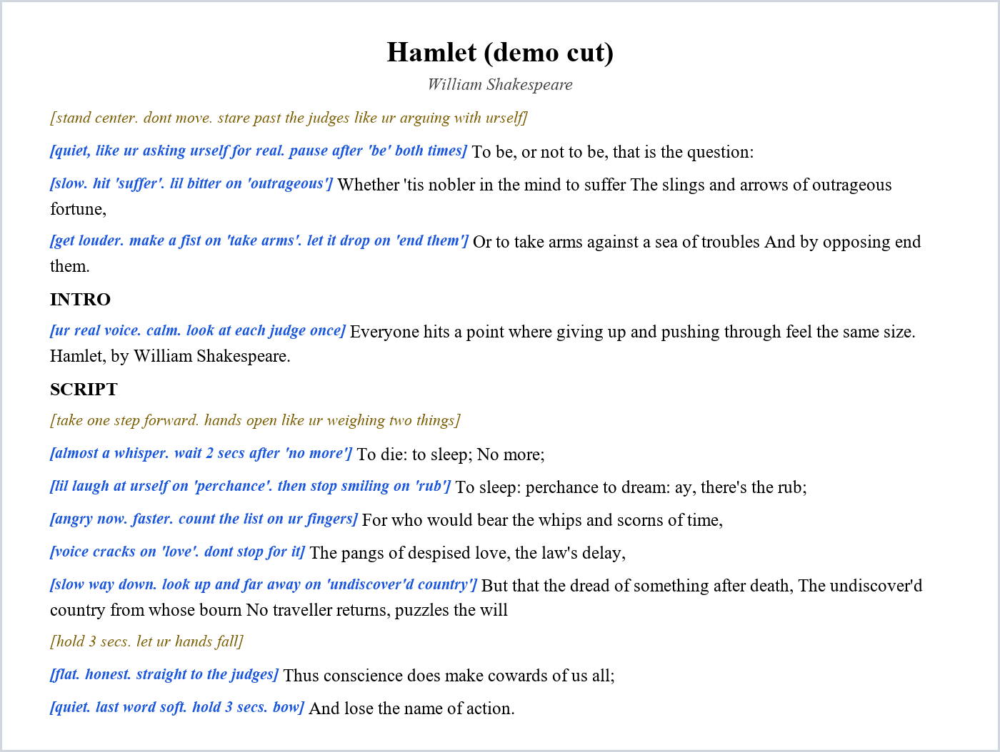

<div align="center">

# 🎭 Script Cut

**Turn a 60-page play into a 10-minute speech & debate piece. In one command.**

AI agent skills for high school interp (DI, HI, Duo, POI). Find a script, cut it to time at *your* pace, and get blocking + how-to-say-it notes on every single line.

[](https://github.com/AkarshSharma2012/script-cut-skill/actions/workflows/ci.yml)


[Install](#install-in-30-seconds) · [Commands](#commands) · [Demo](examples/hamlet) · [Rules it follows](skills/script-cut/references/interp-guide.md)

</div>

---

## The problem

Cutting an interp script is the worst part of the season. You read a whole play, guess what to keep, count words by hand, run it, go 11 minutes over, and do it again. Then you still have to figure out blocking.

## What it does

```text
/script-cut my-play.pdf DI
```

You get a `.docx` like this, sized to your pace, with every spoken line checked word-for-word against the original:

<div align="center">

<br><sub>Demo uses public-domain <i>Hamlet</i>. <b>Blue</b> = how to say it. <b>Gold</b> = what to do. <b>Black</b> = the author's exact words.</sub>
</div>

Plus an **"if ur over time"** list of what to cut first, and what never to cut.

## Commands

| Command | What it does |
| --- | --- |
| `/script-find` | Finds scripts for your event, theme, cast, and length. Free full PDFs first. Checks it's really a monologue and really the full script. |
| `/script-explain` | Build-up, climax, conclusion, scene list, characters, how much popping. |
| `/script-cut` | Cuts to under 10:00 at your pace. Teaser, intro, blocking, tags on every line, verified against the source. |
| `/script-block` | Rewrites blocking and voice notes as clear commands, in the way you talk. Never touches script words. |
| `/script-intro` | 2-3 intro options with word count and time. |
| `/script-time` | Time from word count or your stopwatch run. Tells you exactly what to cut. Learns your real pace. |
| `/script-judge` | Ballot-style review: blockable? understandable? rules? can it break? top 3 fixes. |

No slash commands in your agent? Just say **"use script-cut to cut my-play.pdf for DI"**.

## Install in 30 seconds

Paste this into Claude Code, Codex, or any coding agent:

> Set up the Script Cut skills from https://github.com/AkarshSharma2012/script-cut-skill. Read INSTALL.md, use the installer for this host, keep my existing configuration, and show me how to use it.

Or do it yourself:

```sh
git clone https://github.com/AkarshSharma2012/script-cut-skill.git
cd script-cut-skill
node scripts/install.mjs --host claude     # or codex, jcode, agents
pip install pypdf python-docx               # for the line checker
```

Full details in [INSTALL.md](INSTALL.md). Nothing is downloaded, no accounts, no paid APIs.

## Built for competition, not just "AI writing"

- ✂️ **Cut, never rewrite.** Spoken lines are the author's exact words in order. The intro is the only new text. A checker flags any line that doesn't match, so you don't get DQ'd.
- ⏱️ **Honest timing.** Uses your measured pace. Estimates are labeled until you time a real run.
- 🎬 **Actually blockable.** Everything is mime-able, no props. DI defaults to monologue style with minimal popping.
- 🧑‍⚖️ **Judge-aware.** Picks the climax first, keeps live scenes over summary, adds signposts so judges don't get lost.
- 🔒 **Safe.** Never emails or messages anyone. Never edits your original scripts or docs.
- 📚 **Copyright aware.** Only cuts from a copy you provide. For web-only scripts you get links and a plan.

Rules follow NSDA style (10:00 + 30s grace, no props). Your coach has the final say for your circuit.

## Works with

| Agent | Install |
| --- | --- |
| Claude Code | `node scripts/install.mjs --host claude` |
| Codex | `node scripts/install.mjs --host codex` |
| jcode | `node scripts/install.mjs --host jcode` |
| Other agents | `--host agents` or `--target <skills folder>` |
| Claude.ai | Zip each folder in `skills/` and upload |

## The line checker

```sh
python skills/script-cut/scripts/build_cut.py check  script.pdf cut.json --wpm 149
python skills/script-cut/scripts/build_cut.py build  script.pdf cut.json "My Cut.docx"
```

Reports spoken words, estimated time, lines that don't match the source, lines out of order, and lines missing a delivery tag. Try it on the [Hamlet demo](examples/hamlet).

## Contributing

Students, coaches, and alumni welcome. Easy wins: add rules for your league (NCFCA, Stoa, state, college), add a public-domain demo, or make a command's output clearer. See [CONTRIBUTING.md](CONTRIBUTING.md) and issues tagged **good first issue**.

If this saved you a weekend of cutting, a ⭐ helps other interpers find it.

MIT licensed. No analytics, accounts, telemetry, or paid services. [Security](SECURITY.md)
